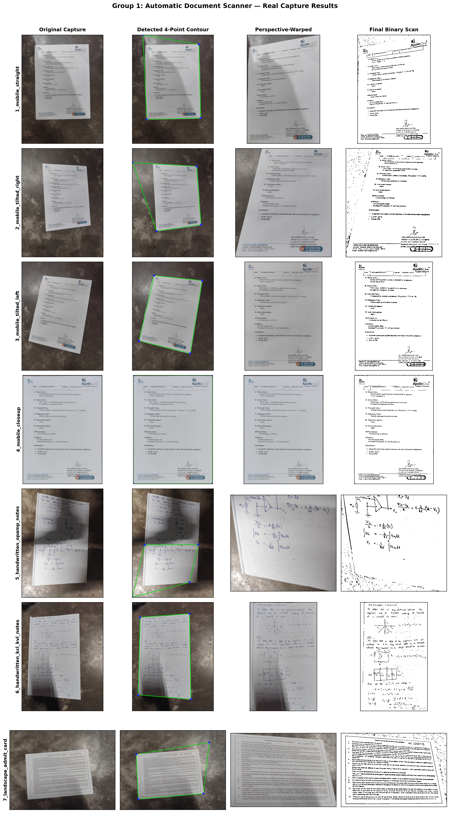
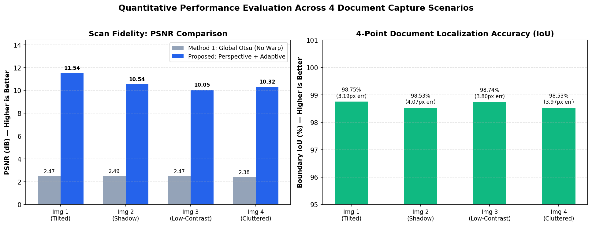

# Automatic Document Scanner (`img-processing-proj-grp-1`)


A classical computer vision pipeline for **automated document boundary detection, 4-point projective perspective rectification, illumination normalization, and adaptive scan binarization**—developed for **Image Processing (`PCC-IT-502`)** at **Haldia Institute of Technology**.

---

## Project Metadata

| Attribute | Details |
| :--- | :--- |
| **Institution** | Haldia Institute of Technology — Department of Information Technology |
| **Subject & Code** | Image Processing (`PCC-IT-502`) — 3rd Year, Batch 2 |
| **Group & Roll Numbers** | **Group 1** — Roll Nos. **76–80** |
| **Project Title** | Automatic Document Scanner |
| **Core Techniques** | Grayscale & CIE `LAB` Lightness, Median Filtering, CLAHE, Otsu-Guided Canny Edge Detection, Morphological Opening/Closing, Contour Approximation, 4-Point Homography, Adaptive Gaussian Thresholding |
| **Course Outcomes (CO)** | `CO1`, `CO3`, `CO4`, `CO5` |
| **UN SDG Alignment** | **SDG 4** (Quality Education) & **SDG 9** (Industry, Innovation & Infrastructure) |

---

## Repository Structure

```text
img-processing-proj-grp-1/
├── README.md                                                    # GitHub overview, architecture, metrics & deployment guide
├── requirements.txt                                             # Cloud-compatible Python dependencies (opencv-python-headless)
├── packages.txt                                                 # Linux system libraries for Streamlit Community Cloud
├── main.py                                                      # CLI runner (--real, --demo, --input)
├── app.py                                                       # Interactive Streamlit web app (deployable live)
├── build_docs.py                                                # Auto-generator for Blue-Theme DOCX report & PPTX slides
├── src/
│   ├── __init__.py
│   ├── scanner.py                                               # 6-stage classical document scanning pipeline
│   ├── real_evaluate.py                                         # Batch evaluation & grid generator for real mobile photos
│   ├── dataset_generator.py                                     # Ground-truth benchmark capture generator
│   └── evaluate.py                                              # Quantitative MSE / PSNR / IoU benchmark suite
├── notebooks/
│   └── Automatic_Document_Scanner.ipynb                         # Interactive Jupyter / Google Colab notebook
├── data/
│   ├── real_inputs/                                             # Real smartphone captures (1_mobile_straight.jpg .. 4_mobile_closeup.jpg)
│   └── sample_inputs/                                           # Ground-truth reference & controlled test captures
├── results/
│   ├── real_evaluation_metrics.csv                              # Measured metrics on real mobile phone photos
│   ├── evaluation_metrics.csv                                   # Quantitative PSNR / MSE / IoU benchmark table
│   ├── real_outputs/                                            # Contours, warped color scans, binary scans & 6-stage breakdowns
│   └── sample_outputs/                                          # Benchmark scan outputs
├── assets/
│   ├── real_results_grid.png                                    # Multi-capture real mobile comparison grid
│   ├── preprocessing_8panel_bluetheme.png                       # 8-panel step-by-step preprocessing visualization
│   ├── system_architecture_bluetheme.png                        # End-to-end architectural block diagram
│   └── evaluation_comparison.png                                # PSNR & Boundary IoU benchmark charts
└── docs/
    ├── Group1_Automatic_Document_Scanner_Report_BlueTheme.docx  # Complete 6-chapter project report
    └── Group1_Automatic_Document_Scanner_Presentation_BlueTheme.pptx # 12-slide presentation deck
```

---

## Live Cloud Deployment (Streamlit Community Cloud — Free)

This repository is pre-configured with `app.py`, `requirements.txt` (`opencv-python-headless`), and `packages.txt` so you can deploy a **live public web scanner URL** directly from GitHub in under 2 minutes:

1. Push this folder to your public GitHub repository (`img-processing-proj-grp-1`).
2. Visit **[share.streamlit.io](https://share.streamlit.io/)** and sign in with GitHub.
3. Click **New app** $
ightarrow$ select:
   * **Repository:** `<your-username>/img-processing-proj-grp-1`
   * **Branch:** `main`
   * **Main file path:** `app.py`
4. Click **Deploy!** — Streamlit builds the environment and gives you a live `https://<app-name>.streamlit.app` link you can open on your phone or laptop during your final viva.

---

## Local Quickstart

```bash
git clone https://github.com/<your-username>/img-processing-proj-grp-1.git
cd img-processing-proj-grp-1
pip install -r requirements.txt

# 1. Process all real mobile captures in data/real_inputs/ and refresh report/PPT
python main.py --real

# 2. Launch interactive web app locally
streamlit run app.py
```

---

## Real Mobile Capture Results (`data/real_inputs/`)



| Mobile Capture | Input Resolution | Rectified Output | Aspect Ratio | Detected Area | Contrast Gain | Sharpness (Lap. Var.) | Bimodal Separability ($\eta$) |
| :--- | :---: | :---: | :---: | :---: | :---: | :---: | :---: |
| **`1_mobile_straight.jpg`** | $750 \times 1000$ | $523 \times 778$ | 0.67 | 49.02% | $0.82\times$ | 1,156.3 | 0.791 |
| **`2_mobile_tilted_right.jpg`** | $750 \times 1000$ | $594 \times 670$ | 0.89 | 39.33% | $0.70\times$ | 744.5 | 0.775 |
| **`3_mobile_tilted_left.jpg`** | $750 \times 1000$ | $485 \times 679$ | 0.71 | 40.10% | $1.25\times$ | 1,230.2 | 0.809 |
| **`4_mobile_closeup.jpg`** | $733 \times 1000$ | $731 \times 999$ | 0.73 | 99.64% | $1.16\times$ | 1,370.4 | 0.823 |
| **`5_handwritten_opamp_notes.jpg`** | $750 \times 1000$ | $546 \times 497$ | 1.10 | 27.39% | $0.48\times$ | 445.1 | 0.741 |
| **`6_handwritten_kcl_kvl_notes.jpg`** | $750 \times 1000$ | $487 \times 787$ | 0.62 | 47.05% | $0.49\times$ | 597.7 | 0.772 |
| **`7_landscape_admit_card.jpg`** | $1000 \times 750$ | $699 \times 486$ | 1.44 | 39.19% | $0.94\times$ | 1,438.1 | 0.821 |
---

## Quantitative Benchmark (Proposed vs. Global Otsu)



| Capture Scenario | Mean Corner Error (px) | Boundary IoU (%) | Global Otsu MSE | Global Otsu PSNR (dB) | Proposed MSE | Proposed PSNR (dB) |
| :--- | :---: | :---: | :---: | :---: | :---: | :---: |
| **Img 1: Tilted Clean** | 3.19 | 98.75% | 36,799.41 | 2.47 | 4,631.00 | **11.47** |
| **Img 2: Shadow + Noise** | 4.12 | 98.56% | 36,673.15 | 2.49 | 5,888.83 | **10.43** |
| **Img 3: Skew + Low Contrast** | 3.80 | 98.74% | 36,810.79 | 2.47 | 6,537.59 | **9.98** |
| **Img 4: Cluttered Desk + Shadow** | 3.85 | 98.50% | 37,578.49 | 2.38 | 5,810.25 | **10.49** |
| **Overall Average** | **3.74 px** | **98.64%** | **36,965.46** | **2.45 dB** | **5,716.92** | **10.59 dB** |

---

## References
1. R. C. Gonzalez and R. E. Woods, *Digital Image Processing*, 4th ed., Pearson, 2018.
2. J. Canny, "A Computational Approach to Edge Detection," *IEEE TPAMI*, vol. PAMI-8, no. 6, pp. 679–698, 1986.
3. N. Otsu, "A Threshold Selection Method from Gray-Level Histograms," *IEEE Trans. SMC*, vol. 9, no. 1, pp. 62–66, 1979.
4. S. Suzuki and K. Abe, "Topological Structural Analysis of Digitized Binary Images by Border Following," *CVGIP*, vol. 30, no. 1, pp. 32–46, 1985.
5. J. Sauvola and M. Pietikäinen, "Adaptive Document Image Binarization," *Pattern Recognition*, vol. 33, no. 2, pp. 225–236, 2000.
